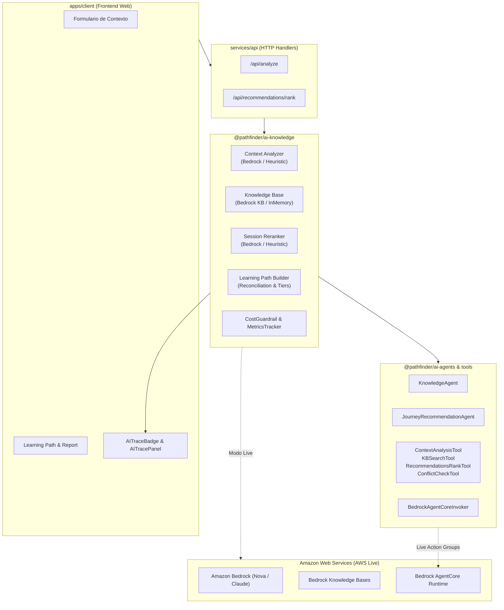

# Arquitectura y Diseño de la Capa de Inteligencia Artificial

**Proyecto:** `re:Invent Pathfinder`  
**Paquetes:** `@pathfinder/ai-contracts`, `@pathfinder/ai-tools`, `@pathfinder/ai-agents`, `@pathfinder/ai-knowledge`  
**Versión:** `v0.22.0`  
**Fecha:** 12 de Octubre, 2026  

---

## 1. Visión General y Filosofía de Diseño

La capa de Inteligencia Artificial de **re:Invent Pathfinder** está concebida bajo el principio de **arquitectura híbrida y resiliente (Cloud-Native + Local-First Fallback)**. Su propósito es procesar el catálogo dinámico de AWS re:Invent y el contexto del asistente para entregar una ruta de aprendizaje hiperpersonalizada, garantizando:

1. **Costo \$0 y Privacidad Total en Demo:** Ejecución puramente local mediante reglas y heurísticas determinísticas, sin credenciales de AWS ni llamadas a APIs externas.
2. **Inferencia Avanzada en Live:** Inferencia con modelos fundacionales de última generación de **Amazon Bedrock**, búsqueda semántica en Managed Knowledge Bases y orquestación multi-agente.
3. **Resiliencia Automática (Graceful Fallback):** Conmutación transparente al motor heurístico si las credenciales de AWS no están configuradas, si hay problemas de conectividad o si se superan los presupuestos.
4. **Cero Cajas Negras (Explainable & Auditable AI):** Telemetría visible en la UI que desglosa modelos, consumo de tokens, latencias y justificaciones matemáticas detrás de cada recomendación.

---

## 2. Mapa Arquitectónico de Paquetes (`ai/`)

El subárbol `ai/` está modularizado en cuatro paquetes desacoplados:

```
ai/
├── contracts/     → Interfaces canónicas de agentes, herramientas y ejecuciones (@pathfinder/ai-contracts)
├── tools/         → Herramientas ejecutables para agentes y Action Groups (@pathfinder/ai-tools)
├── agents/        → Orquestadores autónomos y conector Bedrock AgentCore (@pathfinder/ai-agents)
└── knowledge/     → Motor analítico, RAG, Reranking y Observabilidad (@pathfinder/ai-knowledge)
```



---

## 3. Flujo de Ejecución por Etapas

### Etapa 1: Diagnóstico de Contexto y Detección de Brechas
Evalúa la descripción del proyecto, metas de negocio, seniority y stack actual del asistente.

* **Inferencia en la Nube (`BedrockContextAnalyzer`):**
  - Invoca la **Converse API** de Amazon Bedrock.
  - Modelo predeterminado: **Amazon Nova Micro** (`us.amazon.nova-micro-v1:0`), optimizado para baja latencia y coste mínimo, configurable con Nova Lite, Nova Pro o Anthropic Claude 3.5 Sonnet / Haiku.
  - Utiliza *structured JSON output* para extraer `KnowledgeProfile` y una lista priorizada de `KnowledgeGaps` catalogados con severidad (`critical`, `important`, `exploratory`), impacto y justificación técnica.
* **Inferencia Heurística Local (`HeuristicContextAnalyzer`):**
  - Utilizado en **Modo Demo** o ante ausencia de credenciales de AWS.
  - Mapeo determinístico de dominios (GenAI, Serverless, Event-Driven, Zero Trust, Observabilidad) y deducción de brechas con costo \$0.

---

### Etapa 2: Búsqueda Semántica de Sesiones (RAG)
Cruza las brechas de conocimiento identificadas contra el catálogo oficial de sesiones de AWS re:Invent.

* **Amazon Bedrock Managed Knowledge Bases (`knowledge-base-client.ts`):**
  - Implementa la API `Retrieve` de Bedrock para búsqueda vectorial semántica contra bases vectoriales administradas por AWS (OpenSearch Serverless / Pinecone / Aurora pgvector).
* **Transformador Documental (`session-document-transformer.ts`):**
  - Normaliza las sesiones de AWS Events a documentos semánticos estructurados con metadatos de filtrado (nivel 100-400, venue, tipo de sesión, track temático).
* **Retriever en Memoria (`InMemoryKnowledgeBaseRetriever`):**
  - Ejecuta recuperación vectorial y léxica offline sobre el conjunto de fixtures locales en memoria.

---

### Etapa 3: Reranking Semántico y Scoring Multifactorial
Ordena los candidatos utilizando una ponderación transparente y verificable:

$$\text{RelevanceScore} = 0.40 \cdot \text{GapCoverage} + 0.30 \cdot \text{TopicOverlap} + 0.20 \cdot \text{LevelAlignment} + 0.10 \cdot \text{Logistics}$$

* **Superación de la Anomalía Softmax:**
  - Los modelos LLM de reranking tienden a dispersar las probabilidades entre múltiples candidatos, generando scores excesivamente bajos (3%–5%).
  - El sistema implementa un **rescalado defensivo y penalización por brechas** para que las sesiones de alta relevancia reflejen scores congruentes (75%–95%).
* **Generación de Explicaciones Justificadas:**
  - Cada recomendación incluye una justificación en lenguaje natural que detalla la relación directa entre la sesión y la brecha del asistente (p. ej., *"Recomendada (SEC301 nivel 300): aborda directamente tu brecha en Zero Trust Identity..."*).

---

### Etapa 4: Reconciliación de Agenda y Clasificación por Tiers
El módulo `learning-path-builder.ts` cruza las recomendaciones con la agenda personal de reservas y favoritos del asistente mediante el evaluador determinístico de conflictos:

1. 🌟 **Ruta Principal (`primary`):** Sesiones de alta relevancia ($\ge 0.70$) que cubren brechas críticas y **no tienen conflictos de horario**.
2. 🔄 **Alternativas (`alternative`):** Sesiones de relevancia moderada ($\ge 0.60$) o sesiones excelentes que **colisionan con un compromiso ya confirmado** en la agenda.
3. 🧭 **Exploratorias (`exploratory`):** Sesiones complementarias ($< 0.60$ o sin cobertura directa de brechas) conservadas para enriquecer la perspectiva del asistente sin descartes arbitrarios.

---

## 4. Agentes Autónomos y Bedrock AgentCore Runtime

La arquitectura incluye agentes desacoplados capaces de orquestar flujos autónomos:

* **`KnowledgeAgent` (`knowledge-agent.ts`):**
  - Agente especializado en analizar la arquitectura técnica del usuario, descubrir vacíos formativos y consultar la base de conocimiento de sesiones.
* **`JourneyRecommendationAgent` (`journey-recommendation-agent.ts`):**
  - Agente enfocado en evaluar la factibilidad horaria, resolver solapamientos y planificar la secuencia del asistente.
* **`BedrockAgentCoreInvoker` (`agentcore-runtime.ts`):**
  - Conector nativo con **Amazon Bedrock AgentCore Runtime**. Permite que los agentes se ejecuten en la nube como agentes gestionados con **Action Groups**, traduciendo las herramientas locales en llamadas de herramientas de LLM.
  - Cuenta con bucle de orquestación local para ejecución desacoplada sin conexión a AWS.

---

## 5. Observabilidad, Seguridad y Control de Costos

Para evitar fugas de presupuesto o cuellos de botella por latencia, la capa incorpora:

* **`CostGuardrail` (`cost-guardrail.ts`):**
  - **Límite por Solicitud:** Máximo 4,000 tokens configurables.
  - **Presupuesto Acumulado:** Límite configurable por sesión (por defecto \$10.00 USD).
  - **Degradación Elegante:** Si una solicitud excede las restricciones presupuestarias o de tamaño, el guardrail conmuta automáticamente a la heurística sin interrumpir el flujo del usuario.
* **`AiMetricsTracker` (`ai-metrics-tracker.ts`):**
  - Registro de auditoría por cada inferencia: operación realizada, `modelId`, latencia en milisegundos, tokens de entrada y salida, costo estimado en USD y estado de fallback (`success`, `fallback`, `budget-exceeded`).

---

## 6. Auditoría y Trazabilidad en la Interfaz de Usuario

La plataforma traslada la transparencia técnica al usuario final mediante componentes dedicados:

* **`AITraceBadge`:** Muestra en cada tarjeta e informe si el diagnóstico o recomendación provino de *Bedrock Live* o *Heurística Local*.
* **`AITracePanel`:** Panel contextual desplegable que audita:
  - Modelo fundacional invocado (`us.amazon.nova-micro-v1:0`, `anthropic.claude-3-haiku`, etc.).
  - Latencia exacta del procesamiento (ms).
  - Consumo de tokens (input/output).
  - Factores de ponderación que justificaron la elección de la sesión.
