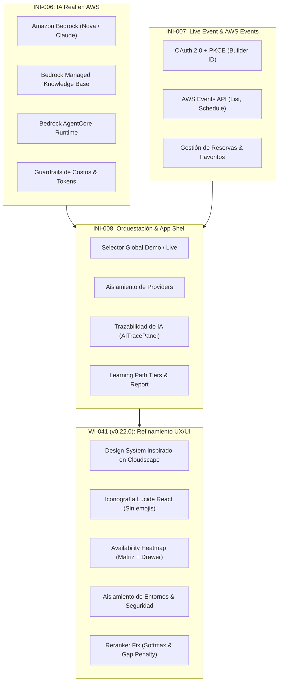

# Informe de Evolución: INI-006 a WI-041 (Release v0.22.0)

**Proyecto:** `re:Invent Pathfinder`  
**Rango de Evolución:** Iniciativas **INI-006**, **INI-007**, **INI-008** y Estabilización **WI-041**  
**Versión Actual:** `v0.22.0` (Tag Git: `v0.22.0`)  
**Fecha:** 12 de Octubre, 2026  

---

## 1. Resumen Ejecutivo

Durante este ciclo de desarrollo, **re:Invent Pathfinder** evolucionó desde un prototipo con heurísticas locales hacia una **plataforma completa, resiliente y profesional** para asistentes de AWS re:Invent. 

La evolución se estructuró en cuatro grandes hitos:
1. **INI-006:** Habilitación de IA generativa real en la nube de AWS (Amazon Bedrock, AgentCore y Knowledge Bases gestionadas) con salvaguardas de costo y fallback offline.
2. **INI-007:** Integración en vivo con el evento real (OAuth con AWS Builder ID, consumo de AWS Events API, disponibilidad en tiempo real, agenda y reservas).
3. **INI-008:** Orquestación integral de la experiencia, creación del App Shell, trazabilidad transparente de IA y separación de modos de usuario.
4. **WI-041 (v0.22.0):** Estabilización funcional profunda, aislamiento estricto Demo vs. Live, rediseño visual inspirado en **AWS Cloudscape** (reemplazo de emojis por Lucide React), solución al ranking del Learning Path y nuevo Heatmap de disponibilidad interactivo.

---

## 2. Mapa Conceptual de la Evolución



---

## 3. Detalle por Hito e Iniciativa

### 🔹 INI-006: Habilitación de IA Real en AWS (Bedrock + AgentCore + Managed KB)
* **Objetivo:** Conectar el motor de razonamiento a servicios reales de Amazon Web Services sin perder la capacidad de operar sin conexión.
* **Componentes y Cambios Clave:**
  - **Modelos Fundacionales Bedrock (`ai/knowledge`):** Integración del AWS SDK Bedrock Runtime con soporte nativo para **Amazon Nova** (Nova Micro / Lite / Pro) y Claude para el análisis semántico de gaps y ordenamiento de sesiones.
  - **Inferencia Dual con Fallback Resiliente:** Mecanismo automático que conmuta entre `BedrockContextAnalyzer` / `BedrockSessionReranker` y analizadores heurísticos locales en caso de fallos de red, cuotas o credenciales ausentes.
  - **Amazon Bedrock Knowledge Bases (Retrieve API):** Integración para búsqueda vectorial de sesiones en Managed Knowledge Bases, coexistiendo con el `InMemoryKnowledgeBaseRetriever`.
  - **Bedrock AgentCore Runtime:** Soporte de ejecución agentic con `Action Groups` y resolución dinámica de herramientas.
  - **Guardrail de Costos y Observabilidad:** Límites de tokens por solicitud, control de consumo presupuestario y métricas de latencia por etapa.

---

### 🔹 INI-007: Live Event Experience — Disponibilidad, Agenda y Reservas
* **Objetivo:** Permitir a los usuarios sincronizar su asistencia real a AWS re:Invent directamente con su cuenta oficial.
* **Componentes y Cambios Clave:**
  - **Autenticación AWS Builder ID (`packages/aws-events`):** Implementación del flujo de autorización OAuth 2.0 con PKCE (Proof Key for Code Exchange) para inicio de sesión en el navegador.
  - **Modelo Agnóstico de Disponibilidad:** Estados estables (`available`, `limited`, `full`, `walk-up`, `unknown`) que aíslan a la UI de las inconsistencias o campos ausentes del API de eventos.
  - **Sincronización Bidireccional de Agenda:** Lectura en vivo de `GetSchedule` y operaciones de confirmación de asientos mediante `ReserveSession` y `FavoriteSession`.

---

### 🔹 INI-008: Experiencia Unificada, Orquestación de Modos y Trazabilidad de IA
* **Objetivo:** Diseñar una experiencia coherente de inicio a fin que maneje con transparencia los modos de uso y la auditoría de IA.
* **Componentes y Cambios Clave:**
  - **App Shell Común:** Barra superior unificada con indicadores de conexión, estado de la ruta y navegación entre vistas (`/`, `/availability`, `/about`).
  - **Orquestación de Modos Demo y Live:** Canales independientes de ejecución para que el usuario pueda explorar el catálogo simulado o conectarse a su cuenta real.
  - **Trazabilidad y Auditoría de IA (`AITracePanel`):** Cada recomendación y diagnóstico ahora incluye un panel de trazabilidad con modelo utilizado, modo de inferencia, tokens consumidos y latencia.
  - **Learning Report Ejecutivo:** Vista de reporte post-evento que cuantifica el retorno educativo, gaps mitigados y distribución horaria.

---

### 🔹 WI-041: Estabilización Funcional y Refinamiento UX/UI (Release v0.22.0)
* **Objetivo:** Resolver inconsistencias visuales, controles desalineados, aislamiento de datos, fallas en el selector de modo, problemas de relevancia en recomendaciones y reestructurar el Heatmap de disponibilidad.
* **Cambios Implementados:**

1. **Design System Inspirado en AWS Cloudscape:**
   - Estandarización de tokens en `tokens.ts`: paleta corporativa navy (`#0f1b2a`), grises slate, acentos naranja (`#ea580c`) y teal (`#0d9488`).
   - Primitivas visuales unificadas (`apps/client/src/components/ui/`): `Button`, `Input`, `Select`, `Badge`, `Card`, `Alert` y `Tooltip`, eliminando estilos HTML nativos desalineados.

2. **Reemplazo Completo de Emojis por Lucide React:**
   - Se eliminaron todos los emojis de la interfaz. Se adoptaron iconos vectoriales SVG limpios y semánticos (`Compass`, `Calendar`, `Clock`, `MapPin`, `Flame`, `Radio`, `Lock`, `ShieldCheck`, etc.).

3. **Rediseño del Selector Demo / Live (`ModeSelector.tsx`):**
   - **Primera visita:** Tarjetas compactas y explicativas.
   - **Modo activo:** Se oculta automáticamente de la pantalla principal y pasa al header de `AppShell.tsx`.
   - **Cambio de modo:** Acción secundaria explícita con diálogo de confirmación interactivo si hay cambios en curso.

4. **Aislamiento Estricto Demo vs. Live:**
   - **Demo:** Ejecución local 100% garantizada con costo $0 en AWS (sin llamadas a Bedrock ni AWS Events).
   - **Live:** Ejecuta inferencia y operaciones contra APIs reales sin inyección silenciosa de mocks en el servidor de desarrollo Vite (`vite.config.ts`).

5. **Seguridad de Sesión y Tokens:**
   - Sustitución de `LocalStorageTokenStore` por almacenamiento en memoria y sesión (`sessionStorage`), evitando la exposición de tokens OAuth de larga duración a través del almacenamiento persistente.

6. **Rediseño del Heatmap de Disponibilidad (`AvailabilityHeatmap.tsx`):**
   - **Tarjetas de Resumen:** Métricas directas de sesiones disponibles, cupos limitados, reservas personales y favoritos.
   - **Barra de Filtros:** Búsqueda textual y filtrado simultáneo por día, sede (venue), formato, nivel y estado.
   - **Matriz Horaria:** Distribución ordenada por sedes y días con visualización clara de estados de capacidad.
   - **Panel Contextual (Drawer):** Vista detallada de cada sesión con horario en tiempo real de Las Vegas (PST), sin cadenas ISO crudas, con botones de reserva y favorito.

7. **Corrección de Calidad del Learning Path (`learning-path-builder.ts`):**
   - Corrección del efecto softmax y rescalado en `session-reranker.ts`, eliminando el problema donde todas las sesiones quedaban con relevancia del 3–5%.
   - Agrupación por niveles de recomendación: **Ruta Principal** (cobertura prioritaria de brechas críticas), **Alternativas** y **Exploratorias**, con justificaciones técnicas desplegables.

8. **Sincronización en Tiempo Real de Reservas en Demo:**
   - `DemoScheduleProvider` ahora actualiza reactivamente su catálogo de sesiones reservadas para que el detector de solapamientos horarios funcione de manera idéntica a una cuenta real.

---

## 4. Matriz de Validación y Calidad Técnica

| Validación | Resultado | Detalle |
| :--- | :---: | :--- |
| **Monorepo Build** | ✅ Aprobado | Compilación TypeScript limpia en los 9 paquetes (`apps/client`, `@pathfinder/domain`, `@pathfinder/ai-knowledge`, `@pathfinder/aws-events`, etc.). |
| **Suite de Pruebas** | ✅ Aprobado | **355 / 355 tests pasados** (100% de éxito, incluyendo 59 pruebas en `@pathfinder/client`). |
| **Linter (ESLint)** | ✅ Aprobado | **0 errores, 0 advertencias**. |
| **Kaddo Methodology** | ✅ Aprobado | `kaddo guard` limpio; Work Item formalizado y archivado en `WI-041`. |
| **Tag de Versión** | ✅ Aprobado | `v0.22.0` etiquetado en el árbol Git (`commit 18832cb`). |

---

## 5. Instrucciones de Ejecución y Pruebas

Para levantar el entorno de desarrollo y probar todos los cambios:

```bash
# 1. Instalar dependencias (si aplica)
pnpm install

# 2. Compilar monorepo
pnpm -r build

# 3. Ejecutar suite de pruebas
pnpm -r test

# 4. Iniciar servidor cliente local
pnpm --filter @pathfinder/client dev
```

Rutas de prueba local en el navegador:
- **Inicio y Journey Adaptativo:** [http://localhost:8484/](http://localhost:8484/)
- **Availability Heatmap:** [http://localhost:8484/availability](http://localhost:8484/availability)
- **Acerca de / Diagnóstico:** [http://localhost:8484/about](http://localhost:8484/about)
